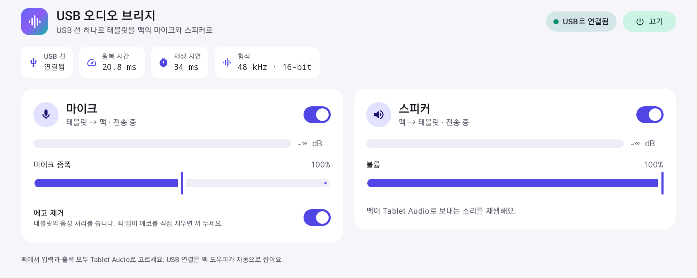
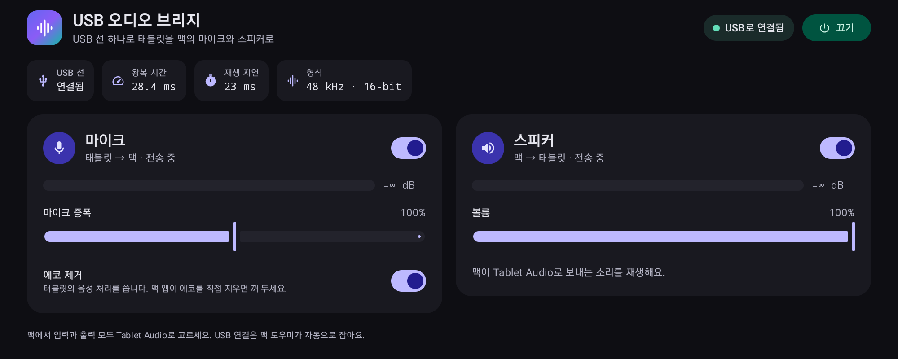

# USB 오디오 브리지

**안드로이드 태블릿을 USB 선 하나로 맥의 마이크·스피커로 써요.**

[English](README.md)

- **선 하나, 와이파이 없이.** 태블릿을 충전하는 USB 선 하나로 소리가 오가요. 네트워크, 페어링, 계정이 필요 없어요.
- **짧은 지연.** 맥 → 태블릿 스피커 → 태블릿 마이크 → 맥 한 바퀴가 약 85ms예요(USB 액세서리 연결에서 잰 값).
- **에코 없음.** 태블릿 스피커에서 나온 맥 소리를 맥이 마이크 소리에서 지워요. 받아쓰기나 통화에 맥 소리가 되들어가지 않아요.
- **화면 꺼진 채 뒤에서 동작.** 태블릿을 꽂으면 화면이 꺼진 채로 브리지가 시작돼요. 선을 다시 꽂거나 연결이 끊겨도 알아서 다시 붙어요.
- **맥과 함께 시작.** 메뉴 막대 도우미가 로그인할 때 자동으로 켜져서, 재부팅한 뒤에도 바로 쓸 수 있어요.
- **맥에는 장치 하나.** 맥 앱에는 입력과 출력이 함께 있는 **Tablet Audio** 장치 하나만 보이고, 볼륨 키도 그대로 먹어요.





## 설치

macOS 15 이상인 맥과 안드로이드 8.0 이상인 태블릿이 필요해요.

1. 태블릿에서 **USB 디버깅**을 켜고(설정 > 개발자 옵션) 맥에 꽂은 다음, 태블릿이 물어보면 이 맥을 허용하세요.
2. 맥에 `adb`를 설치하세요.
   ```sh
   brew install --cask android-platform-tools
   ```
3. **Tablet Audio** 드라이버를 설치하세요. 아직 릴리스에 없어서 이 저장소에서 빌드해요(`brew install cmake` 필요. 암호를 물어보고, 맥 소리가 1초쯤 끊겨요).
   ```sh
   driver/build.sh
   driver/install.sh
   ```
4. [최신 릴리스](https://github.com/floweredao/UsbAudioBridge/releases/latest)에서 `UsbAudioBridge-<버전>-mac.zip`, `UsbAudioBridge-<버전>.apk`, `SHA256SUMS.txt`를 받아 확인하세요.
   ```sh
   shasum -a 256 -c SHA256SUMS.txt
   ```
5. 메뉴 막대 도우미를 설치하고 여세요. 서명은 했지만 공증은 안 해서 격리 표시를 먼저 지워요.
   ```sh
   ditto -x -k UsbAudioBridge-*-mac.zip /Applications
   xattr -dr com.apple.quarantine "/Applications/USB Audio Bridge.app"
   open "/Applications/USB Audio Bridge.app"
   ```
6. macOS가 **마이크 접근**을 물어보면 허용하세요. 도우미는 Tablet Audio 장치로 태블릿 소리를 읽는데, macOS는 이것도 마이크 사용으로 쳐요.
7. 태블릿에 앱이 없으면 도우미가 알아서 설치해요. 직접 설치하려면 `adb install -r UsbAudioBridge-*.apk`를 실행하세요.

## 처음 쓰는 법

1. 태블릿을 꽂으세요. 2초쯤 안에 브리지가 백그라운드에서 시작되고, 태블릿 알림 한 줄로 동작 중임을 보여 줘요. 태블릿 화면은 그대로예요.
2. 맥에서 입력과 출력을 모두 **Tablet Audio**로 고르세요. 시스템 설정 > 사운드에서 바꿔도 되고 Zoom 등 앱 하나에서만 골라도 돼요.
3. 처음 한 번은 태블릿이 *USB 오디오 브리지 앱이 USB Audio Bridge에 액세스하도록 허용하시겠습니까?*를 물어봐요. **연결되면 항상 USB 오디오 브리지 열기**를 체크하고 **확인**을 누르세요. 그러면 더 빠른 USB 액세서리 연결로 바뀌고, 다시 묻지 않아요.
4. 태블릿의 *화면이 꺼져도 계속 동작* 안내에서 **허용**을 누르세요. 배터리 최적화 때문에 브리지가 멈추는 일이 없어져요.

소리가 오가면 메뉴 막대 아이콘이 채워져요. 메뉴에는 연결 상태, 방향별 레벨, 왕복 시간이 보이고, 태블릿 마이크·스피커 켜기/끄기, **Reconnect Tablet**, **Open at Login**, **Show Log**가 있어요.

설정을 바꾸고 싶을 때만 태블릿 앱을 여세요. 마이크·스피커 켜기/끄기, 마이크 증폭, 스피커 볼륨, 태블릿 자체 에코 제거를 바꿀 수 있어요. 맥이 이미 에코를 지우고 있으니 이 스위치는 꺼 두세요. 켜면 지연이 약 60ms 늘어요.

## 자주 묻는 것

**태블릿에서 소리가 안 나요.**
맥 앱의 출력이 Tablet Audio인지, 태블릿 미디어 볼륨이 올라가 있는지 확인하세요. 메뉴의 *Speaker* 레벨을 보면 맥이 소리를 보내고 있는지 알 수 있어요.

**맥 앱에 태블릿 소리가 안 들어가요.**
앱 입력을 Tablet Audio로 고르고 메뉴의 *Mic* 레벨을 보세요. 레벨은 움직이는데 앱에 무음만 녹음되면 시스템 설정 > 개인정보 보호 및 보안 > 마이크에서 USB Audio Bridge를 허용하세요.

**재부팅하거나 오래 쉬고 나면 맥 소리가 블루투스 스피커로 가요.**
블루투스 스피커나 헤드셋이 붙으면 macOS가 알아서 그 장치를 입력·출력으로 바꿔요. 그러면 Tablet Audio로 녹음하던 앱이 시작에 실패할 수 있어요. 시스템 설정 > 사운드에서 Tablet Audio를 한 번 골라 두면, 태블릿이 꽂혀 있는 동안 새로 붙은 장치가 가져간 자리를 도우미가 Tablet Audio로 되돌려요. 직접 다른 장치를 고르면 다시 Tablet Audio를 고를 때까지 그대로 둬요. 도우미 로그에 `default input set back to Tablet Audio`가 남아요.

**메뉴가 *Waiting for the tablet*에서 안 넘어가요.**
`adb devices`를 실행해 보세요. *unauthorized*라면 태블릿에 뜬 USB 디버깅 허용 창에서 허용하세요. `adb`가 없으면 메뉴에 *adb not found*가 뜨니 설치 2단계대로 설치하세요.

**메뉴에 *Tablet Audio driver is not installed*가 떠요.**
`driver/build.sh`와 `driver/install.sh`를 실행하세요.

**태블릿 앱에 "마이크를 쓸 수 없어요"가 떠요.**
메뉴에서 **Reconnect Tablet**을 누르거나 태블릿 앱을 한 번 여세요.

**지연이 평소보다 길어요.**
태블릿이 아직 느린 adb 연결을 쓰고 있을 수 있어요. 태블릿 잠금을 한 번 풀어 *처음 쓰는 법* 3단계의 허용 창이 뜨게 하고 *항상 열기*를 체크하세요. 그러면 도우미 로그에 `aoa: tablet linked`가 남아요.

**"port 47123 is busy"가 떠요.**
도우미가 하나 더 떠 있어요. 하나를 종료하세요.

로그: 맥은 `~/Library/Logs/UsbAudioBridge/helper.log`, 태블릿은 `adb logcat -s UsbAudioBridge`.

## 동작 방식

```
맥 앱 ──► Tablet Audio(출력) ──► 메뉴 막대 도우미 ──USB──► 태블릿 스피커
맥 앱 ◄── Tablet Audio(입력) ◄── 메뉴 막대 도우미 ◄──USB─── 태블릿 마이크
```

소리는 48kHz 16비트 PCM이고 5ms 단위로 오가요. 도우미는 두 가지 USB 연결 중 하나로 소리를 옮겨요.

- **USB 액세서리(AOA, 우선).** 도우미가 태블릿을 Android Open Accessory 모드로 바꾸고 USB 벌크 전송으로 직접 주고받아요. USB 디버깅은 그대로 쓸 수 있어요.
- **adb(대체 경로).** `adb reverse` 위의 TCP예요(마이크 47123, 스피커 47124 포트). 태블릿이 액세서리 모드를 허용하기 전까지 써요. 방향마다 소켓 여러 개를 번갈아 써서 소리가 고르게 흘러요.

**지연.** 루프 테스트(맥 → 태블릿 스피커 → 공기 → 태블릿 마이크 → 맥), 삑 소리 10번의 중앙값이에요.

| 연결 | 태블릿 에코 제거 끔 | 켬 |
| --- | --- | --- |
| USB 액세서리(AOA) | 84.5 / 88.8 ms | 148 ms |
| adb | 142.8 / 150.6 ms | 203.5 / 209.5 ms |

태블릿 재생 버퍼는 10ms에서 시작해 실제로 끊겼을 때만 늘어나고, 양쪽 모두 1초 넘게 남은 여분은 버려요. 그래서 오래 써도 지연이 쌓이지 않아요. 직접 재 보려면 이렇게 하세요.

```sh
open -n -W "/Applications/USB Audio Bridge.app" --args --loop-test 10 --out /tmp/loop.txt; cat /tmp/loop.txt
```

**에코 제거.** 도우미가 태블릿 스피커로 보낸 소리를 기준 신호로 삼고, 마이크 소리를 조각마다 speexdsp 에코 제거기와 잔향 억제기에 통과시켜요. 잡음 제거와 자동 음량은 꺼 두어서 목소리는 그대로예요. 어떤 앱이 Tablet Audio에서 녹음할 때만 켜지고, 5ms 조각마다 CPU 약 0.2~0.3ms를 쓰며 버퍼를 더 쓰지 않아요. 태블릿에서 재 보니 Tablet Audio 입력의 맥 소리는 20~31dB 줄고, 목소리 자리에 튼 시험음은 0.8dB만 줄었어요. 항상 켜거나 끄려면 `defaults write com.floweredao.usbaudiobridge.mac aec on`(또는 `off`), 자동으로 돌리려면 `defaults delete com.floweredao.usbaudiobridge.mac aec`.

**프로토콜.** 모든 메시지는 `[type u8][length u32 big-endian][payload]` 형식이고, 종류는 AUDIO(1), PING(2), PONG(3), HELLO(4)예요. 마이크는 s16le 모노, 스피커는 s16le 스테레오예요. 액세서리 이름은 제조사 `floweredao`, 모델 `UsbAudioBridge`예요. adb만 쓰려면 `defaults write com.floweredao.usbaudiobridge.mac aoa -bool false`를 실행하고 도우미를 다시 켜세요.

## 구성

| 폴더 | 내용 |
| --- | --- |
| `android/` | 태블릿 앱(Kotlin, Jetpack Compose, Material 3, minSdk 26). 포그라운드 서비스가 마이크를 녹음하고 맥 소리를 재생해요. 화면이 꺼져도 계속 돌고, 끊기면 알아서 다시 붙어요. |
| `driver/` | 맥 가상 오디오 장치 **Tablet Audio**([libASPL](https://github.com/gavv/libASPL) 기반, MIT). 도우미만 여는 숨은 포트도 함께 만들고, 앱이 낸 소리가 Tablet Audio 입력으로 되돌아오지 않게 이어져 있어요. |
| `mac/` | 메뉴 막대 도우미(Swift, macOS 15 이상). `adb`로 태블릿을 찾아 태블릿 앱의 브리지 서비스를 설치·시작하고, USB로 연결하고, 에코를 지우고, 태블릿과 Tablet Audio 사이로 소리를 옮겨요. `mac/Sources/CSpeexDSP`에 speexdsp(BSD-3-Clause)가 들어 있어요. |

## 직접 빌드

Xcode 16 이상(Swift 6), JDK 17(`brew install openjdk@17`), CMake, Android SDK 35(`brew install --cask android-commandlinetools` 후 `sdkmanager "platforms;android-35" "build-tools;35.0.0"`)가 필요해요.

```sh
# Tablet Audio 드라이버(지우려면 driver/install.sh -u)
driver/build.sh
driver/install.sh

# 안드로이드 앱
cd android
echo "sdk.dir=/opt/homebrew/share/android-commandlinetools" > local.properties
JAVA_HOME=$(brew --prefix openjdk@17)/libexec/openjdk.jdk/Contents/Home ./gradlew assembleRelease
adb install -r app/build/outputs/apk/release/app-release.apk

# 맥 도우미(위 APK를 함께 넣어요. 인증서를 고르려면 SIGN_IDENTITY="...")
cd ../mac
./scripts/build-app.sh
ditto "dist/USB Audio Bridge.app" "/Applications/USB Audio Bridge.app"
open "/Applications/USB Audio Bridge.app"
```
