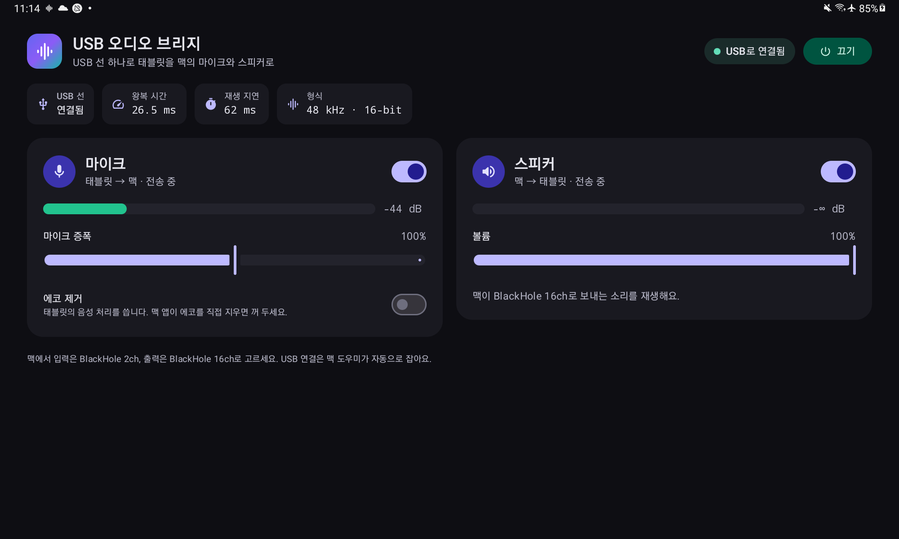
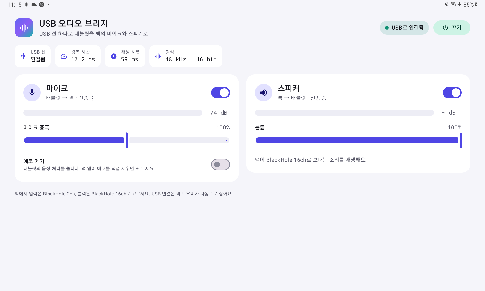

# USB 오디오 브리지

안드로이드 태블릿을 **USB 선 하나로** 맥의 **마이크와 스피커**로 씁니다. 와이파이는 필요 없어요.

```
맥 앱 ──► Tablet Audio(출력) ──► 맥 도우미 ──USB(adb reverse, TCP 47124)──► 태블릿 스피커
맥 앱 ◄── Tablet Audio(입력) ◄── 맥 도우미 ◄──USB(adb reverse, TCP 47123)─── 태블릿 마이크
```

AudioRelay 같은 앱은 소리를 UDP로 보내는데, adb는 UDP를 넘기지 못해요. 이 프로젝트는 48kHz 16비트 PCM을 TCP로 보내서 이미 연결된 USB 디버깅 선으로 그대로 오가게 합니다.

| 다크 | 라이트 |
| --- | --- |
|  |  |

## 구성

| 폴더 | 내용 |
| --- | --- |
| `android/` | 태블릿 앱(Kotlin, Jetpack Compose, Material 3, minSdk 26, targetSdk 34). 포그라운드 서비스가 마이크를 녹음하고 맥 소리를 재생해요. 화면이 꺼져도 계속 돌고, 끊기면 알아서 다시 붙어요. |
| `driver/` | 맥 가상 오디오 장치 **Tablet Audio**([libASPL](https://github.com/gavv/libASPL) 기반 Audio Server 플러그인, MIT). 입력과 출력이 한 장치에 있어서 맥 앱에는 장치 하나만 보여요. 플러그인은 도우미만 여는 숨은 *Tablet Audio Bridge Port*도 함께 만들어요. 둘은 같은 시계를 쓰고 서로 엇갈려 이어져 있어요(Tablet Audio 출력 → 포트 입력, 포트 출력 → Tablet Audio 입력). 그래서 앱이 낸 소리가 Tablet Audio 입력으로 되돌아오지 않아요. |
| `mac/` | 메뉴바 도우미(Swift, macOS 15 이상). adb로 태블릿 연결을 감지해 `adb reverse`를 걸어요. 앱이 없으면 설치하고, 마이크 권한을 주고, 앱을 실행한 다음 Tablet Audio 브리지 포트와 태블릿 사이로 소리를 옮겨요. |

## 준비물

- 맥: `driver/`의 Tablet Audio 드라이버(아래)와 `adb`(`brew install --cask android-platform-tools`). BlackHole은 더 필요 없어요.
- 드라이버를 빌드하려면 CMake(`brew install cmake`)가 필요해요. libASPL은 빌드할 때 `v3.1.2` 태그로 받아와요.
- 태블릿: 안드로이드 8.0 이상. **USB 디버깅**을 켜고 이 맥을 허용해 두세요.
- 직접 빌드하려면 Xcode 16 이상(Swift 6), JDK 17(`brew install openjdk@17`), Android SDK 35(`brew install --cask android-commandlinetools` 후 `sdkmanager "platforms;android-35" "build-tools;35.0.0"`)가 필요해요.

## 빌드와 설치

```sh
# Tablet Audio 드라이버(암호를 물어봐요. coreaudiod를 다시 켜서 소리가 1초쯤 끊겨요)
driver/build.sh
driver/install.sh                 # 지우려면 driver/install.sh -u

# 안드로이드 앱
cd android
echo "sdk.dir=/opt/homebrew/share/android-commandlinetools" > local.properties
JAVA_HOME=$(brew --prefix openjdk@17)/libexec/openjdk.jdk/Contents/Home ./gradlew assembleRelease
adb install -r app/build/outputs/apk/release/app-release.apk

# 맥 도우미(위 APK를 함께 넣고 Apple Development 인증서로 서명)
cd ../mac
./scripts/build-app.sh            # 인증서를 고르려면 SIGN_IDENTITY="..."
ditto "dist/USB Audio Bridge.app" "/Applications/USB Audio Bridge.app"
open "/Applications/USB Audio Bridge.app"
```

처음 실행하면 **마이크 접근** 허용을 물어봐요. **허용**을 눌러 주세요. macOS는 Tablet Audio 브리지 포트를 읽는 것도 마이크 사용으로 쳐요.

## 쓰는 법

1. 태블릿을 USB로 꽂으면 2초쯤 안에 도우미가 `adb reverse`를 걸고 앱을 열어요. 이때 태블릿 화면도 켜져요.
2. 맥에서 **입력과 출력 모두 Tablet Audio**로 고르세요. 시스템 전체로 바꿔도 되고 Zoom, Discord 같은 앱 하나에서만 골라도 돼요.
3. 연결되면 메뉴바 아이콘이 채워져요. 메뉴에는 다음이 있어요.
   - 태블릿 연결 상태
   - 방향별 상태와 레벨
   - 왕복 시간과 마이크 버퍼 크기
   - 태블릿 마이크·스피커 켜기/끄기
   - **Reconnect Tablet**
   - **Open at Login**
   - **Show Log**
4. 태블릿 앱에서는 마이크·스피커를 켜고 끄고, 마이크 증폭과 스피커 볼륨을 조절하고, 태블릿 자체 에코 제거를 켤 수 있어요. 왕복 시간과 재생 지연도 보여요. 화면은 시스템 설정에 따라 다크·라이트로 바뀌고, 가로·세로 배치에 맞춰져요.
5. 태블릿의 *화면이 꺼져도 계속 동작* 안내에서 **허용**을 누르면 배터리 최적화 때문에 멈추는 일이 없어요.

## 지연

- 방향마다 소켓을 다섯 개 써요. 하나는 핑용이고, 나머지 넷이 소리 조각을 번갈아 실어 날라요. adb는 소켓 하나에 확인 안 된 패킷을 하나만 보내기 때문에, 소켓이 하나면 소리가 몰려서 와요. 넷으로 나누면 패킷이 끊기지 않고 흘러요.
- 태블릿 재생 버퍼는 10ms에서 시작해요. 실제로 끊김이 생기면 5ms씩 늘리고(최대 40ms), 5초 동안 끊김이 없으면 다시 5ms씩 줄여요.
- 맥 마이크 버퍼는 15ms를 목표로 해요.
- 양쪽 모두 1초 동안 계속 남아 있던 여분은 버려서 지연이 쌓이지 않게 해요.
- 소리는 5ms 단위로 오가고, 도우미의 장치 버퍼는 128프레임이에요.
- 이 태블릿의 마이크는 빠른 캡처 경로가 없어서 소리를 20ms 덩어리로 내줘요. 그래서 마이크 쪽 지연은 그 아래로 줄지 않아요.

`--loop-test`로 전체 경로를 잴 수 있어요. 맥이 Tablet Audio로 삑 소리를 내면 태블릿 스피커가 재생하고, 태블릿 마이크가 그 소리를 들어요. 도우미는 그 소리가 Tablet Audio 입력에 도착하는 시간을 재요.

```sh
open -n -W "/Applications/USB Audio Bridge.app" --args --loop-test 10 --out /tmp/loop.txt; cat /tmp/loop.txt
```

## 문제 해결

| 증상 | 해결 |
| --- | --- |
| 메뉴에 *adb not found* | `brew install --cask android-platform-tools` |
| *Waiting for the tablet*에서 안 넘어감 | `adb devices`를 확인하세요. *unauthorized*라면 태블릿에 뜬 USB 디버깅 허용 창에서 허용하세요. |
| 태블릿 앱에 "마이크를 쓸 수 없어요" | 안드로이드 11부터는 앱이 화면에 보일 때 시작된 서비스만 녹음할 수 있어요. 잠금을 풀고 앱을 한 번 열거나 메뉴에서 **Reconnect Tablet**을 누르세요. |
| 메뉴에 *Tablet Audio driver is not installed* | `driver/build.sh`와 `driver/install.sh`를 실행하세요. |
| 태블릿에서 소리가 안 남 | 맥 앱의 출력이 Tablet Audio인지 확인하세요. 메뉴의 Speaker 레벨도 확인하세요. |
| 맥 앱에 태블릿 소리가 안 들어옴 | 앱 입력을 Tablet Audio로 고르고 메뉴의 Mic 레벨을 확인하세요. |
| "port 47123 is busy" | 도우미가 이미 하나 더 떠 있어요. 하나를 종료하세요. |
| 태블릿에 맥 소리가 무음으로 감 | 시스템 설정 > 개인정보 보호 및 보안 > 마이크에서 USB Audio Bridge를 허용하세요. |

로그: 맥은 `~/Library/Logs/UsbAudioBridge/helper.log`, 태블릿은 `adb logcat -s UsbAudioBridge`.

## 프로토콜

모든 메시지는 `[type u8][length u32 big-endian][payload]` 형식이에요. 종류는 AUDIO(1), PING(2), PONG(3), HELLO(4)예요. 맥은 연결을 받으면 HELLO를 보내고, PING을 받으면 같은 내용을 담은 PONG으로 답해요. 마이크는 s16le 모노, 스피커는 s16le 스테레오이고 둘 다 48kHz예요.
