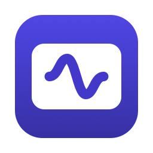
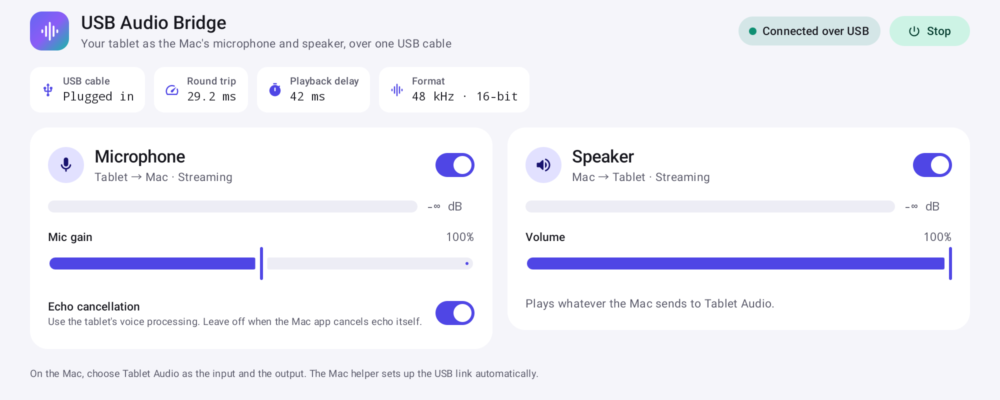
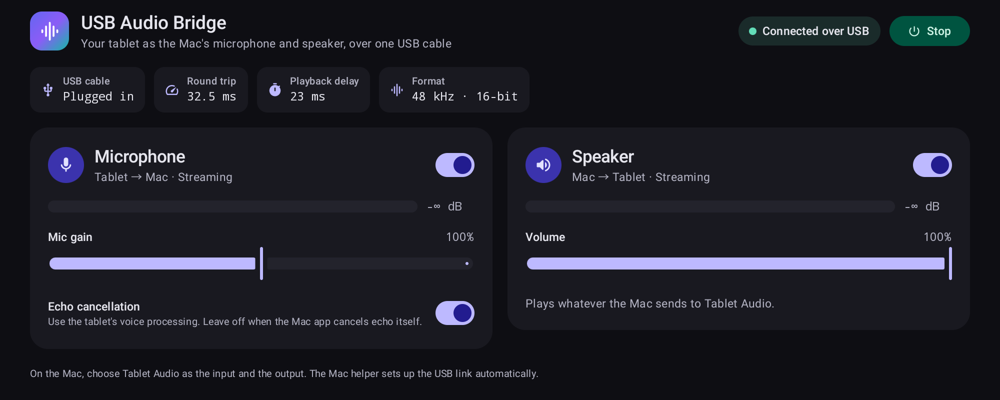

# USB Audio Bridge

**Turn an Android tablet into your Mac's microphone and speaker with one USB cable.**

[한국어](README-ko.md)

- **One cable, no Wi-Fi.** Audio travels over the same USB cable that charges the tablet. No network, pairing, or account.
- **Low delay.** About 85 ms from the Mac through the tablet speaker and back through the tablet mic, measured over the USB accessory link.
- **No echo.** The Mac removes its own sound from the tablet mic, so dictation and calls don't pick up what the tablet speaker plays.
- **Runs in the background.** Plug in the tablet and the bridge starts with the screen off. It reconnects by itself after a replug or a dropped link.
- **Starts with your Mac.** The menu bar helper opens at login, so the bridge is ready after every restart.
- **One device on the Mac.** Mac apps see a single **Tablet Audio** device for both input and output, and the volume keys work on it.





## Install

You need a Mac with macOS 15 or later and an Android tablet with Android 8.0 or later.

1. On the tablet, turn on **USB debugging** (Settings > Developer options), plug it into the Mac, and allow this Mac when the tablet asks.
2. On the Mac, install `adb`:
   ```sh
   brew install --cask android-platform-tools
   ```
3. Install the **Tablet Audio** driver. It is not in the release yet, so build it from this repository (needs `brew install cmake`; asks for your password and drops Mac audio for about a second):
   ```sh
   driver/build.sh
   driver/install.sh
   ```
4. Download `UsbAudioBridge-<version>-mac.zip`, `UsbAudioBridge-<version>.apk`, and `SHA256SUMS.txt` from the [latest release](https://github.com/floweredao/UsbAudioBridge/releases/latest), then check them:
   ```sh
   shasum -a 256 -c SHA256SUMS.txt
   ```
5. Install the menu bar helper and open it. The helper is signed but not notarized, so remove the quarantine flag first:
   ```sh
   ditto -x -k UsbAudioBridge-*-mac.zip /Applications
   xattr -dr com.apple.quarantine "/Applications/USB Audio Bridge.app"
   open "/Applications/USB Audio Bridge.app"
   ```
6. Allow **microphone access** when macOS asks. The helper reads what Mac apps play to Tablet Audio through the driver's hidden port, which macOS counts as microphone input; without it the tablet speaker stays silent.
7. The helper installs the tablet app by itself when it is missing. To install it yourself instead, run `adb install -r UsbAudioBridge-*.apk`.

## First use

1. Plug in the tablet. Within about two seconds the bridge starts in the background and a notification on the tablet shows it is running. The tablet screen stays as it is.
2. On the Mac, choose **Tablet Audio** as the input and the output, either in System Settings > Sound or in a single app such as a video-call app.
3. The first time, the tablet asks *Allow USB Audio Bridge to access USB Audio Bridge?*. Tick **Always open USB Audio Bridge when USB Audio Bridge is connected** and tap **OK**. This moves audio onto the faster USB accessory link and is not asked again.
4. On the tablet, tap **Turn off battery limit** on the *Keep running with the screen off* banner and allow it, so battery optimization never pauses the bridge.

The menu bar icon fills in when the tablet is linked. Its menu shows the connection, a level meter for each direction, the round-trip time, and whether echo cancellation is on, with switches for the tablet mic and speaker, **Reconnect Tablet**, **Open at Login**, and **Show Log**.

Open the tablet app when you want its controls: mic and speaker on/off, mic gain, speaker volume, and the tablet's own echo cancellation. Leave that switch off when the Mac already removes echo; it adds about 60 ms.

## FAQ

**The tablet plays no sound.**
Check that the Mac app's output is Tablet Audio and that the tablet's media volume is up. The *Speaker* meter in the menu shows whether the Mac is sending anything. If the menu says *Microphone access is off*, choose **Open Microphone Settings…** and allow USB Audio Bridge; the helper needs it to read what Mac apps play.

**Mac apps hear nothing from the tablet.**
Choose Tablet Audio as the app's input and watch the *Microphone* meter in the menu. If the meter moves but the app records silence, allow that app in System Settings > Privacy & Security > Microphone.

**After a restart or a long break, Mac sound goes to a Bluetooth speaker instead.**
When a Bluetooth speaker or headset connects, macOS makes it the input and output on its own, and apps that record from Tablet Audio can then fail to start. Once you have chosen Tablet Audio in System Settings > Sound, the helper puts it back whenever a newly connected device takes over while the tablet is plugged in. If you pick another device yourself, the helper leaves it alone until you choose Tablet Audio again. The helper log shows `default input set back to Tablet Audio`.

**The menu stays on *Waiting for the tablet on USB*.**
Run `adb devices`. If the tablet shows *unauthorized*, accept the USB debugging prompt on the tablet. If `adb` is missing, the menu says *adb not found*; install it as in step 2. The helper does not search your `PATH`; it looks only in `/opt/homebrew/bin`, `/usr/local/bin`, and the `platform-tools` folder of `~/Library/Android/sdk` or `/opt/homebrew/share/android-commandlinetools`.

**The menu says *Tablet Audio driver is not installed*.**
Run `driver/build.sh` and `driver/install.sh`.

**The tablet mic shows *busy or blocked*.**
Close other tablet apps that use the mic, then open the tablet app once with the screen on, or choose **Reconnect Tablet** in the menu.

**The delay feels higher than usual.**
The tablet may still be on the slower adb link. Unlock the tablet once so it can show the accessory prompt from *First use* step 3, and tick *Always open*. The helper log then shows `aoa: tablet linked`. If the prompt goes unanswered, the helper tries again about 10 minutes later.

**"Another copy of USB Audio Bridge is already running".**
Another copy of the helper is running. Quit it, then open the app again. The helper log shows `port 47123 is busy`.

Logs: `~/Library/Logs/UsbAudioBridge/helper.log` on the Mac (at 1 MB it moves to `helper.log.1`) and `adb logcat -s UsbAudioBridge` for the tablet.

## How it works

```
Mac apps ──► Tablet Audio (output) ──► menu bar helper ──USB──► tablet speaker
Mac apps ◄── Tablet Audio (input)  ◄── menu bar helper ◄──USB─── tablet microphone
```

Audio is 48 kHz 16-bit PCM in 5 ms frames. The helper moves it over one of two USB links:

- **USB accessory (AOA, preferred).** The helper switches the tablet to Android Open Accessory mode and sends audio over raw USB bulk pipes. USB debugging stays available.
- **adb (fallback).** TCP over `adb reverse` (ports 47123 for the mic and 47124 for the speaker), used until the tablet allows accessory mode. Each direction uses several sockets so audio keeps flowing evenly.

**Latency.** Loop test (Mac → tablet speaker → air → tablet mic → Mac), median of 10 beeps:

| Link | Tablet echo cancellation off | on |
| --- | --- | --- |
| USB accessory (AOA) | 84.5 / 88.8 ms | 148 ms |
| adb | 142.8 / 150.6 ms | 203.5 / 209.5 ms |

The tablet keeps a playback buffer that starts at 10 ms, grows only after a real underrun, and shrinks again once playback runs smoothly. Both sides drop surplus that lasts a full second, so the delay does not creep up over long sessions. Measure your own setup with:

```sh
open -n -W "/Applications/USB Audio Bridge.app" --args --loop-test 10 --out /tmp/loop.txt; cat /tmp/loop.txt
```

**Echo cancellation.** What the helper sends to the tablet speaker is the reference, and every mic frame runs through speexdsp's echo canceller and residual echo suppressor. Noise suppression and automatic gain stay off, so your voice is untouched. It is applied only while an app records from Tablet Audio (in between, the filter keeps adapting) and costs about 0.2-0.3 ms of CPU per 5 ms frame, with no extra buffering. On the tablet it lowered the Mac's sound on the Tablet Audio input by 20-31 dB, while a test tone standing in for your voice dropped by only 0.8 dB. Force it with `defaults write com.floweredao.usbaudiobridge.mac aec on` (or `off`); `defaults delete com.floweredao.usbaudiobridge.mac aec` returns to automatic.

**Protocol.** Every message is `[type u8][length u32 big-endian][payload]` with types AUDIO (1), PING (2), PONG (3), HELLO (4), and JOIN (5). On adb, the helper greets each connection with HELLO and the tablet answers with JOIN, naming its session and socket. Mic audio is s16le mono and speaker audio is s16le stereo. The accessory identifies itself as manufacturer `floweredao`, model `UsbAudioBridge`. To stay on adb only, run `defaults write com.floweredao.usbaudiobridge.mac aoa -bool false` and restart the helper.

**Settings.** The helper reads these keys from the `com.floweredao.usbaudiobridge.mac` defaults domain (`defaults write com.floweredao.usbaudiobridge.mac <key> <value>`). Restart the helper after changing one; `defaults delete` returns a key to its default.

| Key | Default | What it does |
| --- | --- | --- |
| `aec` | automatic | `on` or `off` forces the Mac's echo cancellation. Automatic applies it only while an app records from Tablet Audio. |
| `aoa` | `true` | `false` keeps the helper on the adb link and never switches the tablet to accessory mode. |
| `aecSuppress` | `-40` | Residual echo suppression in dB while only the Mac plays. Lower values remove more echo. |
| `aecSuppressActive` | `-15` | Residual echo suppression in dB while you talk over the Mac's sound. Lower values remove more echo but also lower your voice. |

## Project layout

| Folder | What it is |
| --- | --- |
| `android/` | Tablet app (Kotlin, Jetpack Compose, Material 3, minSdk 26). A foreground service records the mic and plays Mac audio, keeps running with the screen off, and reconnects automatically. |
| `driver/` | **Tablet Audio**, a CoreAudio virtual device built on [libASPL](https://github.com/gavv/libASPL) (MIT). It also publishes a hidden port that only the helper opens, wired so that nothing an app plays comes back on the Tablet Audio input. |
| `mac/` | Menu bar helper (Swift, macOS 15+). Finds the tablet through `adb`, installs and starts the tablet app's bridge service, links the tablet over USB, cancels echo, and moves audio between the tablet and Tablet Audio. Includes speexdsp (BSD-3-Clause) in `mac/Sources/CSpeexDSP`. |

## Build from source

Needs Xcode 16+ (Swift 6), JDK 17 (`brew install openjdk@17`), CMake, and Android SDK 35 (`brew install --cask android-commandlinetools`, then `sdkmanager "platforms;android-35" "build-tools;35.0.0"`).

```sh
# Tablet Audio driver (driver/install.sh -u removes it)
driver/build.sh
driver/install.sh

# Android app
cd android
echo "sdk.dir=$(brew --prefix)/share/android-commandlinetools" > local.properties
JAVA_HOME=$(brew --prefix openjdk@17)/libexec/openjdk.jdk/Contents/Home ./gradlew assembleRelease
adb install -r app/build/outputs/apk/release/app-release.apk

# Mac helper (bundles the APK above; SIGN_IDENTITY="..." picks a certificate)
cd ../mac
./scripts/build-app.sh
ditto "dist/USB Audio Bridge.app" "/Applications/USB Audio Bridge.app"
open "/Applications/USB Audio Bridge.app"

# Tests (no tablet or audio device needed)
swift test                                  # in mac/
./gradlew testDebugUnitTest                 # in android/
```

See [CONTRIBUTING.md](CONTRIBUTING.md) for the toolchain, what CI checks, and how to send a change.
